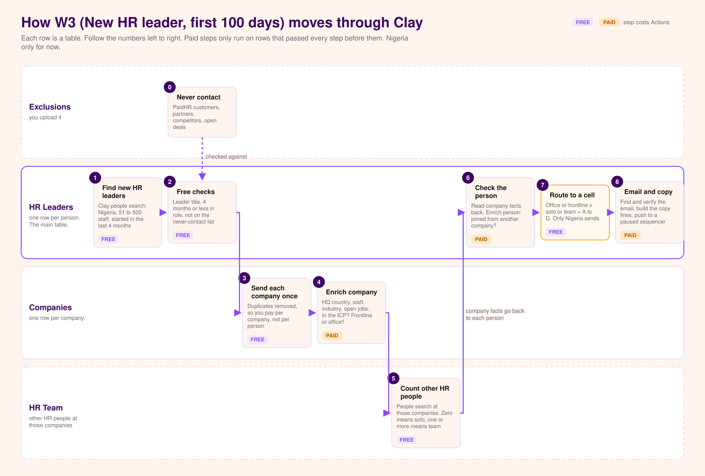

# Clay Build Guide: W3 New HR leader, first 100 days (PaidHR)

A step-by-step guide to building [workflow-spec.md](workflow-spec.md) (in this folder) in Clay. Written for someone who has never built anything in Clay. Follow the parts in order. Each step tells you **why** it exists, **what to click**, **what to type**, **how to check it worked** and **what it costs**.

> **Don't skip the checks.** The most common Clay mistake is running a column on 500 rows before checking it worked on 1. Every step below ends with a check. If the check fails, fix it before moving on.

Built from the spec as of commit `fbfd934` (status: COPY-APPROVED 2026-11-12, Nigeria only, not launch-ready). If the spec changes, this guide is out of date: the spec wins.

---

## Contents

- [What you are building](#what-you-are-building)
- [Clay words you need](#clay-words-you-need)
- [Before you start](#before-you-start)
- [Part 0. Set up the workbook](#part-0-set-up-the-workbook)
- [Part 1. Exclusions table](#part-1-exclusions-table)
- [Part 2. Find the new HR leaders](#part-2-find-the-new-hr-leaders)
- [Part 3. Free gates on each person](#part-3-free-gates-on-each-person)
- [Part 4. Companies table](#part-4-companies-table)
- [Part 5. HR Team table (solo or team?)](#part-5-hr-team-table)
- [Part 6. Bring company facts back to each person](#part-6-bring-company-facts-back-to-each-person)
- [Part 7. Check the person](#part-7-check-the-person)
- [Part 8. Route each person to a cell](#part-8-route-each-person-to-a-cell)
- [Part 9. Find and verify the work email](#part-9-find-and-verify-the-work-email)
- [Part 10. Write the copy lines](#part-10-write-the-copy-lines)
- [Part 11. Views for the operator](#part-11-views-for-the-operator)
- [Part 12. Connect the sequencer (build it, don't run it)](#part-12-connect-the-sequencer)
- [Part 13. Run it every month](#part-13-run-it-every-month)
- [What it costs](#what-it-costs)
- [Final checklist](#final-checklist)
- [When something goes wrong](#when-something-goes-wrong)
- [Things the spec needs to fix](#things-the-spec-needs-to-fix)

---

## What you are building

The spec says: find People or HR leaders at Nigerian companies with 50 to 500 staff who **joined from another company in the last 100 days**, check the company fits, sort each person into one of 4 "cells" (office or frontline company x only HR person or existing HR team), find their email, and fill in the approved copy for a 3-email sequence. Kenya and Ghana are not built yet: the spec holds them until PaidHR confirms it can run payroll there.

You will build **4 tables** inside **1 workbook**:



(Can't see the picture? Open the guide in preview mode: Cmd+Shift+V in VS Code. The same diagram is also in [new-hr-leader-first-100-days-clay-flow.html](new-hr-leader-first-100-days-clay-flow.html) for a browser.)

Each row of the picture is a table. The numbers are the order you build in. Step 0 is the list you upload first.

| # | Table | Step | Cost |
|---|---|---|---|
| 0 | Exclusions | Never contact list | upload |
| 1 | HR Leaders | Find new HR leaders | free |
| 2 | HR Leaders | Free checks | free |
| 3 | Companies | Send each company once | free |
| 4 | Companies | Enrich company, open jobs, ICP and workforce formulas | paid |
| 5 | HR Team | Count other HR people | free |
| 6 | HR Leaders | Company facts back, enrich person | paid |
| 7 | HR Leaders | Route to a cell (A to D) | free |
| 8 | HR Leaders | Email, copy lines, paused sequencer | paid |

Why this shape:
- **People first**, because the trigger is something that happened to a person (they started a new job).
- **Company checks happen once per company** in their own table. If two HR people at one company show up, you pay to enrich that company once.
- **Everything paid runs last**, and only on rows that passed every free check before it.

What a finished row in **HR Leaders** looks like, reading left to right (made-up example):

| Person | Title | Company | Started | Country | Workforce | HR team | Joined from | Cell | Ready? | Email | E1 L1 … E3 L2 |
|---|---|---|---|---|---|---|---|---|---|---|---|
| Ada O. | Head of People | Acme Foods | 2026-09 | NG | frontline | team | another company | D | Yes | ada@acme… | Could be off, but since joining Acme Foods in September… |

---

## Clay words you need

| Word | What it means |
|---|---|
| **Workbook** | A folder of tables for one campaign. |
| **Table** | A spreadsheet. One row per company or per person. |
| **Source** | Where a table's rows come from (a Clay search, a CSV, another table). |
| **Column** | One piece of information per row. Three kinds matter: **plain** (you type or import it), **formula** (Clay calculates it, free), **enrichment / action** (Clay calls a data provider or AI, usually costs). |
| **Formula** | A small calculation, like a spreadsheet formula. Free. Clay has an AI helper: describe what you want in plain English and it writes the formula for you. |
| **Enrichment** | A column that looks something up (company size, a person's past jobs, an email). Costs **Actions**, and sometimes **Data Credits**. |
| **Lookup** | A column that reads a matching row from another table in your workbook. Free. |
| **Send table data** | A column that copies rows from this table into another table. Free. |
| **Run condition** ("Only run if") | A rule on a paid column: it only runs on rows where the rule is true. This is how you avoid paying for rows you'll throw away. |
| **Auto-run** | When on, new columns run on every row by themselves. **Keep it off** while building. |
| **Actions** | Clay's main usage meter. About 1 Action per enrichment per row. Unused Actions expire monthly. |
| **Data Credits** | A second meter, used when Clay pays a data provider for you (for example, email finders). |
| **View** | A saved filter on a table, like "only rows ready to send". |
| **Waterfall** | One column that tries several email providers in order until one finds a valid email. |
| **Cell** | This campaign's word for one of the 4 versions of the copy (A, B, C, D). Not a spreadsheet cell. |

---

## Before you start

Tick these off before you build.

- [ ] **Clay account** with access to the workspace you'll build in. Note the plan (Settings → Plans & billing). You need enough Actions for roughly: companies + people + email lookups. See [What it costs](#what-it-costs).
- [ ] **Email finder connections** (Settings → Connections), if you'll use your own provider keys. Without them, Clay uses its own and charges Data Credits.
- [ ] **The spec is open** next to you: [workflow-spec.md](workflow-spec.md). Sections 2 (who's in and out), 4 (signals), 5 (cells), 6 (variables) and Copy are what you're building.
- [ ] **The Exclusions CSV** is ready (Part 1 shows exactly what goes in it).
- [ ] **Test size:** import **25 people** first. You can import more later.
- [ ] **Know what's still missing before anything sends** (spec "Before launch"): the sender, the customer name checks, PaidHR's customer and open-deal lists. You can build everything without them; you just can't run Part 12.

---

## Part 0. Set up the workbook

**Why:** one place for everything in this campaign, so anyone can find it and follow it.

1. In Clay, click **+ New** (top left) → **Workbook**.
2. Name it: `PaidHR · W3 New HR Leader (100 days) · NG`.
3. In the workbook description, paste: *"Signal: People or HR leaders at Nigerian companies with 50 to 500 staff who joined from another company in the last 100 days. Spec: paidhr-gtm-os/output/campaigns/new-hr-leader-first-100-days/workflow-spec.md. Nigeria only; Kenya and Ghana held."*

**Check:** the workbook appears in your Clay home with that name.
**Cost:** free.

---

## Part 1. Exclusions table

**Why:** the spec (section 2, Exclude) lists companies we must never email: PaidHR's customers, open deals, partners and competitors. One table lets every other table check against it.

### 1.1 Make the CSV

Create a spreadsheet with **3 columns** and save it as `exclusions.csv`:

| Company Name | Domain | Type |
|---|---|---|
| PaidHR | paidhr.com | Self |
| MyCoverGenius | | Customer |
| Cleva | | Customer |
| Filmhouse Group | | Customer |
| Rise (Risevest) | | Customer |
| Go54 | | Customer |
| Mono | | Customer |
| FAMASI | | Customer |
| Sygnite Power & Energy Solutions | | Customer |
| Real Fruit | | Customer |
| Transport Services Limited (TSL) | | Customer |
| M&W Nuts | | Customer |
| Heroshe | | Customer |
| YALO | | Partner |
| Accion | | Investor |
| SeamlessHR | | Competitor |
| Workpay | | Competitor |
| Deel | | Competitor |
| Cadana | | Competitor |
| NotchHR | | Competitor |
| Salario | | Competitor |
| roPay | | Competitor |
| BizEdge | | Competitor |
| Motherboard | | Competitor |
| Xceed365HR | | Competitor |
| SystemSpecs | | Competitor |
| Sage | | Competitor |
| PaySpace | | Competitor |
| Oze | | Competitor |

Where these come from: customers are every name in [facts.md](../../../context/messaging/facts.md) "Authorized social-proof names" (Heroshe is banned from copy but is still a customer, so it is excluded); competitors are the spec's section 2 list.

**Domain** is how every other table matches against this list, so fill it in for every row. Only `paidhr.com` is filled in here, because it's the only domain in the research files. Find each other one on the company's LinkedIn page or website and check it's the company's own site, not a product or country subdomain. Type it plain: `acme.com`. No `https://`, no `www.`, no slash at the end. A row with a blank domain matches nothing.

> **Why domain and not name:** names clash. "Mono", "Sage" and "Rise" are also names of unrelated companies. A domain belongs to one company.

> When PaidHR sends its real customer list and CRM open deals (spec open item 1, written `{{paidhr_customer_domains}}` and `{{crm_open_deals}}`), add them to this CSV with Type `Customer` or `Open deal` and re-upload.

### 1.2 Upload it

1. Inside the workbook, click **+ Add table** → **Import CSV**.
2. Upload `exclusions.csv`. Name the table `Exclusions`.
3. Change `Domain` to the **URL** data type (column header → Edit column → Data type).

**Check:** 29 rows (plus any PaidHR lists you added), 3 columns.
**Cost:** free.

---

## Part 2. Find the new HR leaders

**Why:** this is the trigger (spec section 1). The spec was written for Apollo through treg; in Clay, the built-in people search does the same job for free and can filter on **when they started the job**, so you don't need the spec's month-to-month ID comparison. You only pay later when you enrich.

### 2.1 Start a people search

1. In the workbook, click **+ Add table** → **Find people**.
2. You'll see a filter panel on the left and a preview of matching people on the right.

### 2.2 Set the filters

Fill in each filter exactly as below. These come from spec section 2.

| Filter | Set it to | Why |
|---|---|---|
| **Job title: include** (current job) | Head of HR · Head of Human Resources · Head of People · Head of People and Culture · HR Manager · Human Resources Manager · Chief People Officer · HR Operations Lead | The 8 trigger titles |
| **Job title: exclude** | Assistant · Intern · Recruit · Talent · Business Partner | Junior or non-payroll roles from the spec's exclude list. Leave out "Officer" here, because it would also remove "Chief People Officer". Part 3 handles "HR Officer" with a formula. |
| **Person location: country** | Nigeria | Kenya and Ghana are held (spec section 7, Country rollout) |
| **Company size** | 51-200 · 201-500 | The spec says 50 to 500. Clay's buckets jump from 11-50 to 51-200, so the real floor is 51. |
| **Company industry: exclude** | Staffing and Recruiting · Human Resources Services | Recruitment, staffing and HR outsourcing firms are out (spec section 2). Do **not** exclude government or non-profits: the spec keeps them in and labels them. |
| **Started current role** (may be called "Time in current role" or "Job start date") | Within the last **5 months** | The spec reads "100 days" as "started in the run month or one of the 4 months before it". A 5-month window catches all of those; Part 3 trims it to exactly 4 months back. If your panel doesn't show this filter, skip it: Part 3's formula does the job. |

### 2.3 Check the number before importing

Look at the **total count** above the preview and write it down: `Nigeria, 51 to 500 staff, started in the last 5 months: ___`.

**Why this matters:** this is the free volume check. The spec's pool sizes came from Apollo, so Clay's number will differ. If it's under about 20, the monthly campaign will be small: tell PaidHR before spending anything.

### 2.4 Import

1. Set the import **limit to 25** (test size; more later).
2. Click **Import** (or **Save to table**). Name the table `HR Leaders`.
3. **Turn Auto-run OFF**: open the table's settings (the ⚙ or "…" menu at the top of the table) → **Auto-update / Auto-run** → off. Do this before adding any column.

### 2.5 Add the two hidden fields

The search knows each person's **company domain** and the **month they started** (`YYYY-MM`), but doesn't always show them as columns.

1. Click any cell in the first column (the search source column). A panel opens with everything the search returned for that person.
2. Find the company domain (inside the matched job, under company → domain). Click it → **Add as column**. Rename it `Company Domain`. Set its type to **URL**.
3. Find the start date (inside the matched job → start date). **Add as column**. Rename it `Start Date`.

### 2.6 Remove duplicates

Table settings → **Deduplicate** → choose `LinkedIn Profile`. If one person appears twice, Clay keeps one. This is also what stops anyone being contacted twice when you re-run the search each month (Part 13).

**Check:** 25 rows. Each row has name, job title, company, LinkedIn Profile, Company Domain and Start Date. Open 3 LinkedIn profiles and confirm they really are HR leaders at Nigerian companies who started recently.
**Cost:** free.

---

## Part 3. Free gates on each person

**Why:** drop rows we know are wrong **before** spending anything. Everything here is free.

**How to add a formula column:** click **+ Add column** (right end of the table) → **Formula**. Type the formula, or click **Use AI** inside the formula box and paste the plain-English description. When a formula refers to another column, type `/` and pick the column. Below, columns are written `{{Column Name}}`.

| Column | Plain English for the AI helper | Formula |
|---|---|---|
| `Title OK?` | True if the job title does NOT contain officer, unless it also contains chief | `!(/officer/i.test({{Job Title}} \|\| "") && !/chief/i.test({{Job Title}} \|\| ""))` |
| `Months in Role` | Whole months between Start Date (YYYY-MM) and today | `{{Start Date}} ? (new Date().getFullYear() - Number({{Start Date}}.slice(0, 4))) * 12 + (new Date().getMonth() + 1 - Number({{Start Date}}.slice(5, 7))) : null` |

**Check `Title OK?`:** "HR Officer" → false. "Chief People Officer" → true. "Head of People" → true.
**Check `Months in Role`:** someone who started `2026-07` shows 4 in November 2026.

### 3.1 `Exclusion Match` (lookup)

1. **+ Add column** → **Lookup single row in other table**.
2. Table: `Exclusions`. Match column in Exclusions: `Domain`. Value from this table: `{{Company Domain}}`.
3. Save, then **run it on all rows** (lookups are free).

**Check:** temporarily add a row to `Exclusions` with the domain of one company in your HR Leaders table. Its `Exclusion Match` should fill in. Then delete the test row.

### 3.2 `Pass Person Gates?`

- **Plain English:** *"True if Title OK is true, Months in Role is 4 or less, and Exclusion Match found nothing."*
- **Formula:**
```javascript
{{Title OK?}} === true && ({{Months in Role}} === null || {{Months in Role}} <= 4) && !{{Exclusion Match}}
```

> **Why 4 months:** the spec's trigger is "started on or after the first day of the month 4 months before the run month". In November that is July onward: July is 4 months back. Some July starts will be up to about 122 days old; the spec accepts that.

**Check:** sort by `Pass Person Gates?`. Open the false rows and make sure each one deserves to be out. If a good row is false, fix the formula, not the row.
**Cost:** free.

---

## Part 4. Companies table

**Why:** company facts (HQ country, staff count, industry, open jobs) are checked **once per company**.

### 4.1 Create the empty table

1. **+ Add table** → **Blank table**. Name it `Companies`.
2. Add two text columns: `Company Domain` (type URL) and `Company Name`.
3. Table settings → **Deduplicate** → `Company Domain`.
4. Turn **Auto-run off** here too.

### 4.2 Send companies over from HR Leaders

In `HR Leaders`:

1. **+ Add column** → **Send table data** (sometimes "Write to table").
2. Destination table: `Companies`.
3. Map: `Company Domain` → `{{Company Domain}}`, `Company Name` → `{{Company}}`.
4. **Run condition:** `{{Pass Person Gates?}} === true`.
5. Run on **1 row**. Open `Companies` and check the company arrived with the right domain.
6. Then run on all rows.

**Check:** `Companies` has no more rows than `HR Leaders`, and no duplicate domains.
**Cost:** free.

### 4.3 Enrich each company

In `Companies`:

1. **+ Add column** → **Enrich Company**. Input: `{{Company Domain}}`.
2. Run on **1 row only**. Click the cell and read what came back.
3. From that cell, **Add as column**: headquarters **country**, **employee count**, **industry**. Rename them `HQ Country`, `Employees`, `Industry`. If you see a LinkedIn company URL, add it too as `Company LinkedIn`.
4. Check the 1 row against the company's LinkedIn page: right country, right size?
5. If yes, run on the rest.

**Cost:** about **1 Action per company**. The first paid step.

### 4.4 Company formulas (free)

| Column | Plain English for the AI helper | Formula |
|---|---|---|
| `Country Code` | NG for Nigeria, KE for Kenya, GH for Ghana, blank otherwise | `({"Nigeria": "NG", "Kenya": "KE", "Ghana": "GH"})[{{HQ Country}}] \|\| ""` |
| `ICP Pass?` | HQ is in Nigeria and the company has 50 to 500 employees | `{{Country Code}} === "NG" && {{Employees}} >= 50 && {{Employees}} <= 500` |
| `Workforce Type` | "frontline" if the industry contains any word from the spec's frontline list, otherwise "office" | see below |
| `Org Type` | public, ngo or standard, from the company name and industry | see below |

`Workforce Type` (spec section 4, signal 2, list copied from the spec):
```javascript
/transport|trucking|logistic|supply chain|warehous|retail|supermarket|wholesale|manufactur|food|consumer goods|hospitality|restaurant|entertainment|renewable|oil|energy|construction|mining|security|facilities|apparel|textile/i.test({{Industry}} || "") ? "frontline" : "office"
```

`Org Type` (spec signal 6, a label for list review only, never in copy):
```javascript
/government|ministry|agency/i.test(({{Company Name}} || "") + " " + ({{Industry}} || "")) ? "public" : /\bngo\b|foundation|international|non-profit|nonprofit/i.test(({{Company Name}} || "") + " " + ({{Industry}} || "")) ? "ngo" : "standard"
```

> **Why the HQ check:** the Part 2 search matches people located in Nigeria, not companies headquartered there. A London company with a Lagos HR manager would slip through. `ICP Pass?` catches it.

> **Workforce Type will misfire on some labels.** The spec's list was written for Apollo's industry names; Clay shows LinkedIn's. For example "Computer and Network Security" contains "security" and will read as frontline. In the check below, fix any wrong row by hand and note it for the spec (see [Things the spec needs to fix](#things-the-spec-needs-to-fix), item 3).

**Check:** pick 5 companies and confirm `Country Code`, `ICP Pass?` and `Workforce Type` by eye. Would you call each one office or frontline?
**Cost:** free.

### 4.5 Open jobs (for the hiring line)

**Why:** spec signal 4. If a company has 3 or more open roles, the copy adds one optional line about onboarding. It's a context line, not a router, so it never decides the cell.

1. **+ Add column** → search for a jobs enrichment (may be called **Find Jobs**, **Find job openings** or **Company job openings**). Input: `{{Company Domain}}` (or `{{Company LinkedIn}}` if it asks for a LinkedIn URL).
2. **Run condition:** `{{ICP Pass?}} === true`.
3. Run on **1 row**. Open the cell and find the list of jobs. Compare with the company's LinkedIn "Jobs" tab.
4. Formula `Open Jobs`: *"the number of job openings in the jobs column"* (let the AI helper write it from the real cell, e.g. `{{Find Jobs}}?.jobs?.length || 0`).
5. Formula `Hiring Wave?`: `{{Open Jobs}} >= 3`.
6. Then run the jobs column on the rest.

**Check:** a company with lots of LinkedIn job posts shows `Hiring Wave?` true.
**Cost:** about **1 Action per ICP-pass company**. If you'd rather not pay for a context line, skip 4.5 and set `Hiring Wave?` to `false`: the copy still works without it.

---

## Part 5. HR Team table

**Why:** spec signal 3, the second router. If the new leader is the only HR person on record, they're setting HR up ("solo"); if others exist, they inherited a team ("team"). Searching is free.

1. In `Companies`, create a view called `ICP pass` (view dropdown at the top of the table → **+ New view**) with one filter: `ICP Pass?` = true.
2. **+ Add table** → **Find people**. At the top of the filters, choose to find people **at companies from a table** (may be called "Companies from table"). Pick table `Companies`, view `ICP pass`.
   > **Why a view and not pasted domains:** the search stays tied to the view, so it always searches exactly the companies that passed, including ones that qualify next month.
3. **Job title: include**: HR · Human Resources · People · Payroll · Talent (the spec's HR title words, junior roles included).
4. Import. Name the table `HR Team`. Add `Company Domain` as a column the same way as Part 2.5.
5. Back in `Companies`: **+ Add column** → **Lookup multiple rows in other table** → table `HR Team`, match `Company Domain` = `{{Company Domain}}`. Name it `HR People Found`.
6. Formulas:

| Column | Plain English | Formula |
|---|---|---|
| `HR Team Count` | Number of rows in HR People Found, minus 1 for the new leader | `Math.max(({{HR People Found}}?.length \|\| 0) - 1, 0)` |
| `HR Team Cluster` | "solo" if HR Team Count is 0, otherwise "team" | `{{HR Team Count}} === 0 ? "solo" : "team"` |

7. Compare the number of companies in `HR Team` with the `ICP pass` view's row count. One domain can match more than one company in Clay's data; if a count looks far too high, open the people and check they belong to the right company.

**Check:** pick one company, open its LinkedIn "People" page and search "HR". Does the count roughly match?
**Cost:** free.

> LinkedIn undercounts small Nigerian companies, so "solo" means "we found no one else". The cell A and C copy is written as a guess ("My guess is…", "probably"), which covers this.

> If the new leader isn't in Clay's people data for their own company, the minus 1 removes someone else. On the test rows, check the new leader appears in `HR People Found`; if most don't, change the formula to not subtract 1 and note it for the spec.

---

## Part 6. Bring company facts back to each person

In `HR Leaders`:

1. **+ Add column** → **Lookup single row in other table** → table `Companies`, match `Company Domain` = `{{Company Domain}}`. Name it `Company Facts`.
2. From one cell, **Add as column**: `Country Code`, `ICP Pass?`, `Workforce Type`, `HR Team Cluster`, `Hiring Wave?`, `Org Type`.

**Check:** a person at a company you checked in Part 4 shows the same values.
**Cost:** free.

---

## Part 7. Check the person

### 7.1 `Enrich Person`

**Why:** the spec only wants leaders who **joined from another company** (internal promotions are excluded).

1. **+ Add column** → **Enrich Person** (from LinkedIn profile). Input: `{{LinkedIn Profile}}`.
2. **Run condition:** `{{Pass Person Gates?}} === true && {{ICP Pass?}} === true`.
3. Run on **1 row**. Open the cell and find the **list of past jobs** (often `experience` or `experiences`). Note which field holds the company name and which holds the company domain or LinkedIn URL.
4. Then run on the rest.

**Cost:** about **1 Action per person**.

### 7.2 `Previous Company` and `Previous Domain`

Use the formula AI helper. Plain English: *"From the Enrich Person result, take the most recent job that is not the current job. Return its company name."* Then the same for its domain.

Roughly (field names depend on your real cell, so let the AI helper write it from the cell):
```javascript
{{Enrich Person}}?.experience?.find(e => !e.is_current)?.company_name || ""
```

### 7.3 `Joined From Outside?`

- **Plain English:** *"True if Previous Company is not empty and Previous Domain is different from Company Domain."*
- **Formula:**
```javascript
!!{{Previous Company}} && {{Previous Domain}} !== {{Company Domain}}
```

**Check:** one person who was promoted internally (if you have one) shows false.

### 7.4 `Still Employed?` (optional, recommended)

**Why:** search data lags. Not in the spec, but recommended for any role-based campaign: one AI check that they still hold the job.

1. **+ Add column** → **Use AI**.
2. Prompt:
   > *Here is a person's work history: {{Enrich Person}}. Are they currently employed at the company with domain {{Company Domain}} as {{Job Title}} or a similar HR leadership title? Answer YES, NO or REVIEW (REVIEW if the evidence is unclear). Give one short piece of evidence.*
3. Output format: **JSON**, with exactly these fields:
   - `response`: text, must be one of `YES`, `NO`, `REVIEW`
   - `evidence`: text
4. **Run condition:** `{{Joined From Outside?}} === true`
5. Run on **2 rows you can judge** against LinkedIn, then the rest.

**What REVIEW means for routing:** not ready. Only `YES` passes. Look at REVIEW rows by hand.
**Cost:** about **1 Action plus a small AI cost per person**.

---

## Part 8. Route each person to a cell

### 8.1 `Cell`

The spec's 4 cells (section 5) are workforce type x HR team.

- **Plain English:** *"A if office and solo, B if office and team, C if frontline and solo, D if frontline and team."*
- **Formula:**
```javascript
({"office": {"solo": "A", "team": "B"}, "frontline": {"solo": "C", "team": "D"}})[{{Workforce Type}}]?.[{{HR Team Cluster}}] || ""
```

### 8.2 `Tax Window?`

Spec signal 5: Nigeria only, 1 December to 31 January (annual PAYE returns due 31 January). This uses today's date, so it's true when you build the copy in those months.

```javascript
{{Country Code}} === "NG" && [12, 1].includes(new Date().getMonth() + 1)
```

> Because this reads **today's** date, re-run the copy formulas (Part 10) on the day you push to the sequencer, not weeks before.

### 8.3 `Ready to Contact?`

Every check from the spec in one column. Only rows with **true** get an email lookup and copy.

- **Plain English:** *"True if all of these are true: Pass Person Gates, ICP Pass, Joined From Outside, Still Employed is YES (or blank if you skipped 7.4), Country Code is NG, and Cell is not blank."*
- **Formula:**
```javascript
{{Pass Person Gates?}} === true && {{ICP Pass?}} === true && {{Joined From Outside?}} === true && ({{Still Employed?}}?.response === "YES" || !{{Still Employed?}}) && {{Country Code}} === "NG" && !!{{Cell}}
```

**Check:** filter `Ready to Contact? = true`. Open every row. Would you be happy for each of these people to get the email?
**Cost:** free.

---

## Part 9. Find and verify the work email

**Why:** the spec only emails verified addresses (section 2, Exclude: unverified email). We only look up emails for people we'll actually contact; this is usually the most expensive step.

1. **+ Add column** → **Find work email** (Clay's email waterfall).
2. Inputs: full name `{{Full Name}}`, company domain `{{Company Domain}}`, LinkedIn `{{LinkedIn Profile}}`.
3. Providers: any you've connected with your own key first, then Clay's. **4 providers is enough.**
4. Turn on **validation** inside the waterfall and choose the strict setting: **don't accept catch-all or risky**.
5. **Run condition:** `{{Ready to Contact?}} === true`.
6. Run on **1 row**. Read the result: an email plus a status such as "valid".
7. Then run on the rest of the `Ready to Contact?` rows.
8. From the waterfall, **Add as column**: `Work Email` (type Email) and `Email Status`.
9. Formula `Email Domain OK?`: *"true if the part of Work Email after the @ equals Company Domain"*: `({{Work Email}} || "").split("@")[1] === {{Company Domain}}`. Rows where it's false go to a review view (Part 11).

**Check:** every row with an email has status valid.
**Cost:** Actions plus Data Credits **for each provider step that actually runs**.

---

## Part 10. Write the copy lines

**Why:** the spec's copy (section "Copy") is approved line by line, and each dynamic line picks its version by cell. Because every version is already written, **these are formulas, not AI**: free and identical every time.

Rules for this Part:
- Every line starts with `!{{Ready to Contact?}} ? "" :` so rows that won't be emailed stay blank.
- The wording inside the quotes is copied **exactly** from the spec. Don't edit it here: change the spec first, then the formula.
- **Spintax stays in the sequencer.** Subjects, CTAs, sign-offs and Email 3's opening line have options like `{Best,|Thanks,}`. Those go in the sequencer template (Part 12), never in Clay.
- For each column, paste the **Plain English** into the formula's Use AI helper and keep it as the column description, then compare what Clay wrote with the formula here.

### 10.1 Helper variables

| Column | Plain English | Formula |
|---|---|---|
| `Company Short` | Company name without Ltd, Limited, PLC | `({{Company}} \|\| "").replace(/\s+(ltd\|limited\|plc)\.?$/i, "").trim()` |
| `Start Month` | Month name of Start Date, e.g. "September" | `["January","February","March","April","May","June","July","August","September","October","November","December"][Number(({{Start Date}} \|\| "").slice(5, 7)) - 1] \|\| ""` |

### 10.2 Email 1

#### `E1 L1`: the situation (routes on Cell)

- **Plain English:** *"If Ready to Contact is false, leave blank. Otherwise pick the cell's opener from the spec's Email 1 L1, filling in Company Short and Start Month."*
- **Formula:**
```javascript
!{{Ready to Contact?}} ? "" :
({
  "A": "My guess is you're setting up HR at " + {{Company Short}} + " more or less from scratch since joining in " + {{Start Month}} + ".",
  "B": "Since you joined " + {{Company Short}} + " in " + {{Start Month}} + ", I imagine you've been getting to know how the team runs payroll.",
  "C": "Joining " + {{Company Short}} + " in " + {{Start Month}} + " probably made you the person who pays everyone across shifts and sites.",
  "D": "Could be off, but since joining " + {{Company Short}} + " in " + {{Start Month}} + " you're likely learning how your team pays people across every shift and site."
})[{{Cell}}] || ""
```
- **Check:** one row per cell you have. Company and month read naturally, nothing blank.

#### `E1 L2`: what it probably means (routes on Cell)

```javascript
!{{Ready to Contact?}} ? "" :
({
  "A": "If a founder or finance ran payroll before you arrived, it's probably landing on your desk about now.",
  "B": "Taking over a process someone else set up usually means checking each run twice until you trust it.",
  "C": "That probably means gathering attendance, overtime and new-joiner details from each site before every run.",
  "D": "With that many staff, one wrong figure or late payment reaches a lot of people at once."
})[{{Cell}}] || ""
```

#### `E1 L3`: the optional context line (routes on Tax Window? then Hiring Wave?)

- **Plain English:** *"If Ready to Contact is false, leave blank. If Tax Window is true, write the Nigeria Tax Act line. Otherwise, if Hiring Wave is true, write the hiring line. Otherwise leave blank. When there is a line, end it with a blank line."*
- **Formula:**
```javascript
!{{Ready to Contact?}} ? "" :
{{Tax Window?}} ? "And 2026 is the first year under the Nigeria Tax Act, with annual PAYE returns due by 31 January.\n\n" :
{{Hiring Wave?}} ? "And with " + {{Company Short}} + " hiring for several roles right now, there's probably a round of onboarding coming too.\n\n" :
""
```
- **Why the `\n\n`:** the sequencer template puts `{{e1l3}}{{e1l4}}` with no gap between them (see [sequencer-export.md](sequencer-export.md)). The line carries its own blank line, so leads without it don't get an empty paragraph.

#### `E1 L4`: what PaidHR does (routes on Cell)

```javascript
!{{Ready to Contact?}} ? "" :
({
  "A": "PaidHR runs payroll and remits PAYE, pension, NHF and NSITF every cycle, and staff get their own payslips without coming to HR.",
  "B": "PaidHR puts approval levels in front of every payroll run and remits PAYE, pension, NHF and NSITF with a receipt for each payment.",
  "C": "In PaidHR, shifts, clock-ins and overtime flow straight into payroll, and new staff onboard themselves.",
  "D": "PaidHR flags failed salary payments so you can re-send them, and lets HR pull a payment receipt the moment someone says they weren't paid."
})[{{Cell}}] || ""
```

#### `Social Proof` (routes on Cell)

```javascript
!{{Ready to Contact?}} ? "" :
({
  "A": "Cleva's CEO ran payroll on one big spreadsheet until it stopped scaling, and now tax and pension run automatically.",
  "B": "At MyCoverGenius, the Head of People now runs payroll on the day it's due, with no prep in the weeks before.",
  "C": "At Sygnite, a solar engineering firm, new staff now fill in their own details instead of HR keying them in.",
  "D": "Filmhouse Group's HR team uses the approval steps to catch last-minute details before salaries go out."
})[{{Cell}}] || ""
```

> **Before launch, each name needs its check** (spec "Before launch" item 2). If Sygnite fails, set cell C's value to `""` and follow the sequencer export's note for cell C.

### 10.3 Email 2

#### `E2 L1`: new value (routes on Cell)

```javascript
!{{Ready to Contact?}} ? "" :
({
  "A": "One thing that helps when you're setting HR up: you can sign up, onboard and run the first payroll in PaidHR on the same day, with no upfront onboarding fee.",
  "B": "On the remittance side, PaidHR remitted ₦934M in PAYE and ₦754M in pension for its customers in 2025, with zero defaults or delays.",
  "C": "Staff on shifts can also pull their own payslips in PaidHR, so those requests stop coming to you.",
  "D": "For a workforce that size, the remittance record matters too: ₦934M in PAYE and ₦754M in pension went through PaidHR in 2025, with zero defaults or delays."
})[{{Cell}}] || ""
```
- **Check:** the ₦ sign shows correctly (copy it from the spec rather than typing it).

#### `E2 L2`: optional hiring line (cells A, B, D only)

```javascript
!{{Ready to Contact?}} ? "" :
({{Hiring Wave?}} && ["A", "B", "D"].includes({{Cell}})) ? "With several roles open at " + {{Company Short}} + ", new joiners can fill in their own details instead of HR keying them in.\n\n" :
""
```

### 10.4 Email 3

#### `E3 L2`: who to speak to (routes on HR Team Cluster)

```javascript
!{{Ready to Contact?}} ? "" :
{{HR Team Cluster}} === "solo"
  ? "If payroll still sits with finance or a founder at " + {{Company Short}} + ", who would be best to speak to?"
  : "Is someone on your team closer to payroll who I should speak to instead?"
```

### 10.5 LinkedIn DM 1 (for the LinkedIn tool, not the email sequencer)

```javascript
!{{Ready to Contact?}} ? "" :
({
  "A": {{First Name}} + ", is payroll moving over to HR at " + {{Company Short}} + " now that you're in, or staying with finance?",
  "B": {{First Name}} + ", are you keeping " + {{Company Short}} + "'s current payroll setup, or reviewing it in your first few months?",
  "C": {{First Name}} + ", do attendance and overtime come to you from each site at " + {{Company Short}} + ", or is that already automated?",
  "D": {{First Name}} + ", is a look at how " + {{Company Short}} + " runs payroll across sites on your list for the coming months?"
})[{{Cell}}] || ""
```

The connection request (no note) and DM 2 (static, with spintax) go straight into the LinkedIn tool from the spec. The LinkedIn tool isn't chosen yet, so there's no push column for it.

### 10.6 Read the whole email

Pick one row from each cell you have. Paste its Email 1 lines into a document in this order: `{{First Name}},` · E1 L1 · E1 L2 · E1 L3 + E1 L4 · Social Proof · the CTA from the spec. Read it out loud. If a line sounds wrong for that person, find the column that produced it and fix that column (or the routing columns feeding it), never the wording.

**Check:** every name, company and month reads naturally; nothing is blank except the optional lines.
**Cost:** free.

---

## Part 11. Views for the operator

In `HR Leaders`, create these views (view dropdown at the top → **+ New view** → add a filter):

| View | Filter | Who uses it |
|---|---|---|
| `Ready to send` | `Ready to Contact?` = true AND `Email Status` = valid AND `Email Domain OK?` = true | The person loading the sequencer |
| `Email review` | `Ready to Contact?` = true AND (`Email Status` is not valid OR `Email Domain OK?` = false) | Someone checking emails by hand |
| `Still employed: review` | `Still Employed?` response = REVIEW | Someone checking LinkedIn by hand |
| `Public and NGO` | `Org Type` is public or ngo | List review (spec keeps them in, labelled) |
| `Dropped` | `Pass Person Gates?` = false OR `ICP Pass?` = false OR `Joined From Outside?` = false | Spot-checking the gates |

In `Ready to send`, hide helper formulas and keep: name, title, company, cell, email, and the copy line columns. **Don't hide paid columns or lookups**: they show where the data came from.

---

## Part 12. Connect the sequencer

**Build this column, but don't run it.** The spec is not launch-ready (no sender, customer name checks pending, PaidHR's customer and open-deal lists missing).

1. In the sequencer (not yet chosen), create the campaign from [sequencer-export.md](sequencer-export.md): name `W3 New HR leader, first 100 days (NG)`, 3 steps at 0 / +3 / +7 days in one thread, subjects, bodies and spintax exactly as written there. **Leave it paused.**
2. In `HR Leaders`: **+ Add column** → the sequencer's "Add lead to campaign" action.
3. Map: email `{{Work Email}}`, first name `{{First Name}}`, company `{{Company Short}}`, and custom fields: `e1l1` → `E1 L1`, `e1l2` → `E1 L2`, `e1l3` → `E1 L3`, `e1l4` → `E1 L4`, `social_proof` → `Social Proof`, `e2l1` → `E2 L1`, `e2l2` → `E2 L2`, `e3l2` → `E3 L2`.
4. **Run condition:** `{{Ready to Contact?}} === true && {{Email Status}} === "valid" && {{Email Domain OK?}} === true`.
5. **Stop.** On launch day: re-run the Part 10 columns (for the tax window), run the push on 1 row, check the lead looks right in the paused campaign, then run the rest.

**Cost:** about **1 Action per lead pushed**.

---

## Part 13. Run it every month

The spec's cadence (section 7) is monthly, on the first working day.

1. Open `HR Leaders` → the search source → re-run the search with the same filters (or use its refresh/schedule option if your plan has one).
2. Deduplicate on `LinkedIn Profile` (Part 2.6) keeps anyone already in the table from appearing twice, so nobody is contacted twice.
3. Run the columns in Part order on the new rows only (filter a view to rows created today, or sort by created date). Every paid column's run condition still applies.

**Cost:** the same per-row costs as the first run, on new rows only.

---

## What it costs

Free: the searches, imports, formulas, lookups, Send table data, views.

Paid, and only on rows that passed every check before it:

| Step | Runs on | Rough cost |
|---|---|---|
| Enrich Company (4.3) | Each company that passed person gates | about 1 Action per company |
| Open jobs (4.5, optional) | ICP-pass companies | about 1 Action per company |
| Enrich Person (7.1) | People at ICP-pass companies | about 1 Action per person |
| Still Employed? (7.4, optional) | People who joined from outside | about 1 Action + a small AI cost per person |
| Email waterfall (9) | `Ready to Contact?` rows only | Actions + Data Credits per provider step that runs |
| Sequencer push (12) | Valid, matching emails only | about 1 Action per lead (not run until launch) |

**Example for the 25-person test** (the counts are made up to show the sum; yours will differ): say 20 people pass Part 3 at 18 companies, 14 companies pass `ICP Pass?` with 15 people at them, 12 joined from outside, 10 are `Ready to Contact?`. That's about 18 (Enrich Company) + 14 (open jobs) + 15 (Enrich Person) + 12 (Still Employed) + (10 x up to 4 waterfall steps) ≈ **60 to 100 Actions**, plus some Data Credits for emails.

Watch the Actions counter (top of Clay) before and after each paid step and write the numbers down. That's your real cost per row.

---

## Final checklist

- [ ] Auto-run is **off** on every table.
- [ ] Every paid column has a **run condition**.
- [ ] Every paid column was tested on **1 row** (AI: 2 rows) and the cell was read before running more.
- [ ] `Companies` has no duplicate domains.
- [ ] Every row in `Exclusions` has a domain, and no excluded company appears in `Ready to send`.
- [ ] No Kenya or Ghana row is `Ready to Contact?`.
- [ ] One sample email per cell was read out loud and makes sense.
- [ ] Copy columns match the spec word for word.
- [ ] Sequencer campaign exists, **paused**, push column built and **not run**.
- [ ] Actions spent are written down per step.

---

## When something goes wrong

| What you see | Likely cause | Fix |
|---|---|---|
| Search shows 0 people | A filter is too strict (often start date or a misspelt title) | Remove filters one at a time to find which one empties it |
| People from other countries | Person location wasn't applied, or the company is HQ'd abroad | Check filters; `ICP Pass?` drops non-Nigerian HQs |
| A column ran on every row and spent Actions | Auto-run was on, or no run condition | Turn auto-run off; add the run condition; note the spend (Actions can't be refunded) |
| Formula shows an error | A column name changed, or a value is blank | Re-pick the column with `/`; guard blanks with `\|\| ""` |
| Lookup finds nothing | Domains written differently (`www.acme.com` vs `acme.com`) | Compare the two values; retype the Exclusions domain plain |
| An office company shows as frontline | The spec's keyword list matched a LinkedIn label (e.g. "Computer and Network Security") | Correct the row by hand; see spec fix 3 |
| Every company is "team" or every one "solo" | HR Team search too broad or too narrow, or the minus 1 is wrong | Open `HR People Found` on 3 companies; see Part 5 notes |
| Previous Company is blank | Only one job on LinkedIn, or the formula points at the wrong field | Open the Enrich Person cell and point the formula at the real field |
| Email status catch-all or risky | The company's mail server accepts everything | Leave it out. Don't send to unverified emails |
| Tax line appears outside December and January | The copy was built in December and pushed later | Re-run Part 10 on launch day |

---

## Things the spec needs to fix

Found while writing this guide. Update [workflow-spec.md](workflow-spec.md) (this guide doesn't edit it):

1. **Section 3, Sources:** written for Apollo through treg (free search, monthly ID comparison, $0.026 enrich, about $65 first run). In Clay, the people search with a start-date filter replaces the ID comparison, and costs are Clay Actions and Data Credits instead. Add a Clay column to Sources, or say which tool is the build of record.
2. **Section 2, Size:** Clay's company size buckets jump from 11-50 to 51-200, so a company with exactly 50 staff is never searched. Change the spec floor to 51, or accept the gap.
3. **Section 4, Signal 2 (workforce type):** the keyword list was written for Apollo's industry names. Against LinkedIn's labels in Clay, "security" catches "Computer and Network Security" and "energy" catches some office firms. Either update the list for LinkedIn labels or change the read to an AI classification of how most staff work, with `frontline / office / unclear` and unclear counting as office.
4. **Section 4, Signal 3 (HR team):** "minus the new leader" assumes the new leader appears in the HR people search for their own company. If they don't, the count is one too low and a "team" can read as "solo". State what to do when the leader isn't found.
5. **Section 4, Signal 6 (`org_type_flag`):** `foreign_parent` needs a parent-company field; Clay's Enrich Company may not return one. Drop `foreign_parent` or name a source.
6. **Section 2, Unverified email:** says Apollo `email_status`. In Clay, it's the waterfall's validation status, plus the email-domain check in Part 9.
7. **Section 6, Variables:** `e1l3` and `e2l2` carry their own blank line (`\n\n`), which is in the sequencer export but not in the spec. Add it to the variables contract.
8. **Not in the spec, added here as optional:** `Still Employed?` (7.4) and the email-domain check (Part 9). Add them to section 2 if PaidHR wants them as rules.
9. **Diagram format:** this Mac has no Google Chrome, so the skill's PNG renderer couldn't run. The diagram at the top is an SVG drawn from the same JSON instead. For the skill's own PNG, install Chrome, run `pip install selenium`, then `python3 .claude/skills/clay-build-plan/scripts/render_flow.py output/campaigns/new-hr-leader-first-100-days/new-hr-leader-first-100-days-clay-flow.json output/campaigns/new-hr-leader-first-100-days/new-hr-leader-first-100-days-clay-flow.png`. (Not a spec problem: a setup note.)
